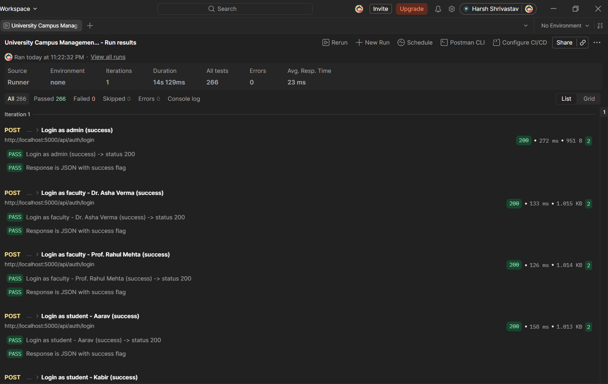
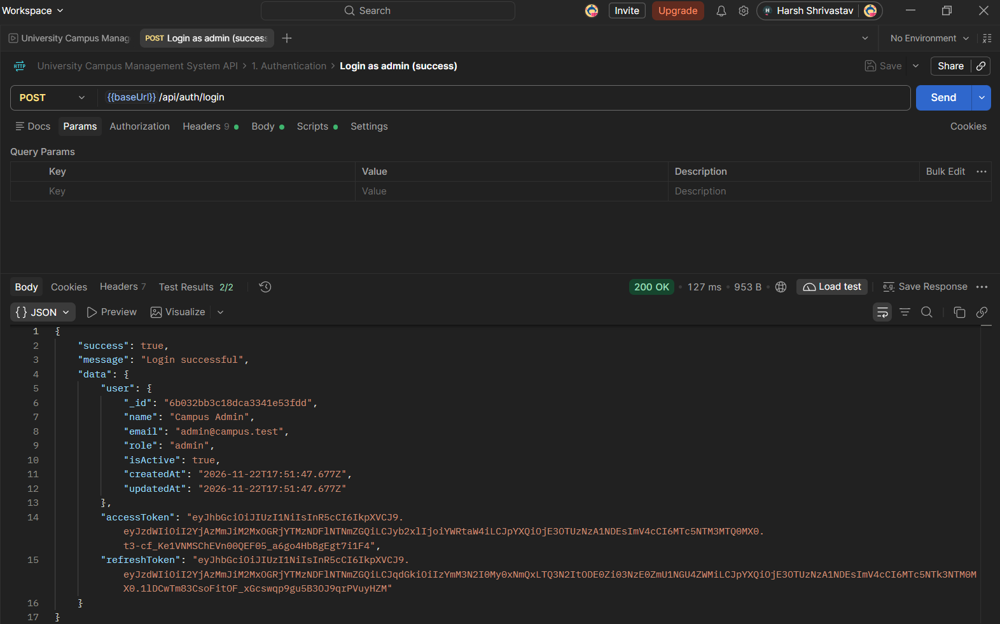
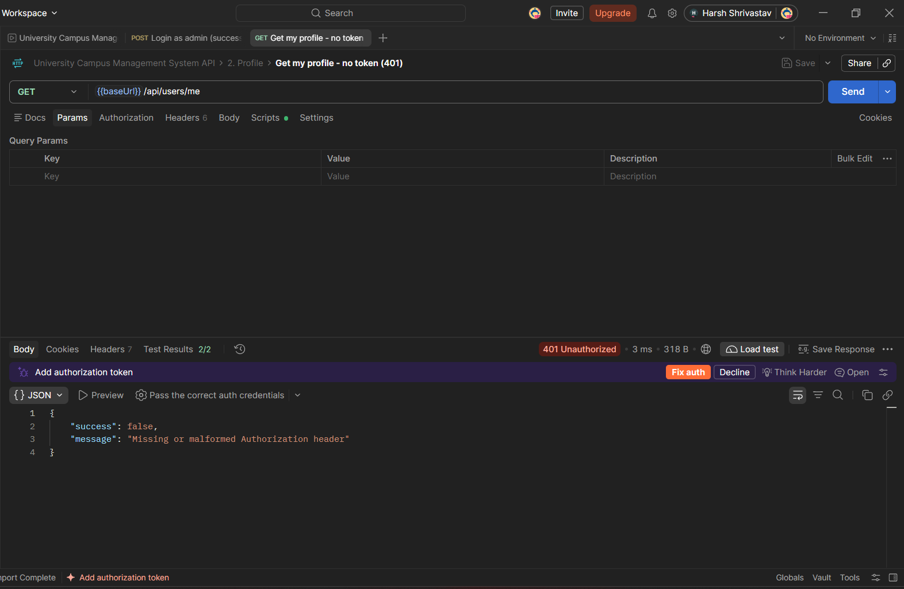
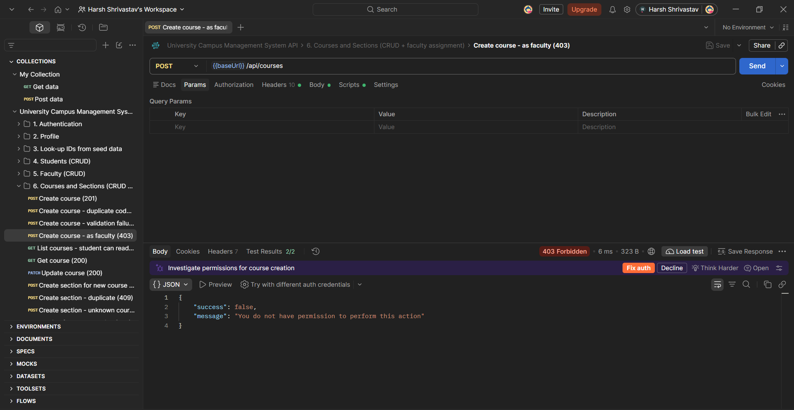
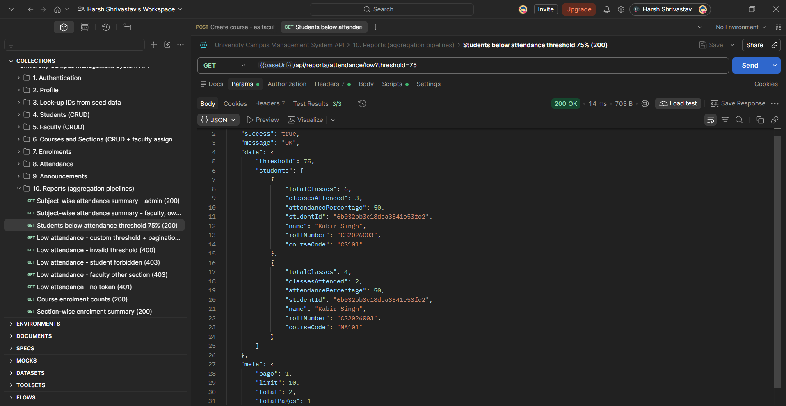
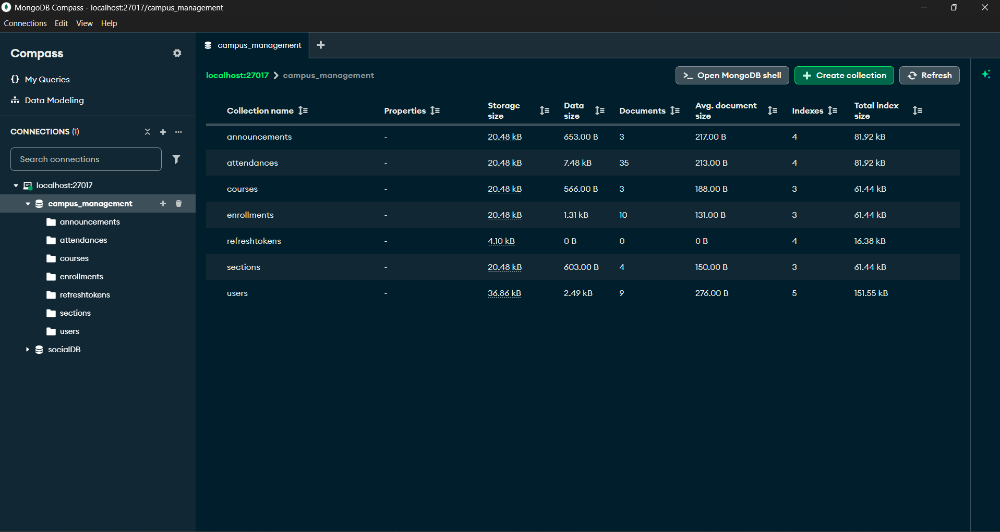
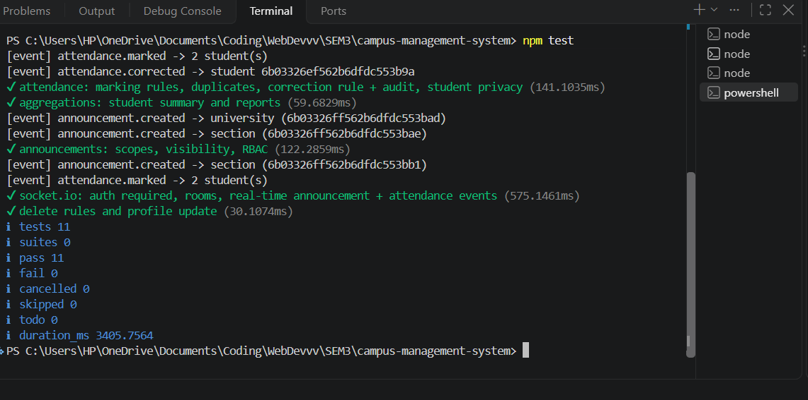

**K.R. MANGALAM UNIVERSITY**

Backend Development – Capstone Project Report

**University Campus Management System**

Node.js · Express.js · MongoDB · Mongoose · JWT · Socket.IO

| **Submitted by (Individual Submission)** |                                                  |
|------------------------------------------|--------------------------------------------------|
| Name                                     | Harsh Shrivastav                                 |
| Roll Number                              | 2501730265                                       |
| Programme                                | B.Tech CSE (AI/ML)                               |
| Section                                  | D                                                |
| Institution                              | K.R. Mangalam University                         |
| Course                                   | Backend Development                              |
| Project                                  | Project 1 – University Campus Management System  |
| Team Size                                | 1 (individual project; group work not permitted) |

---

# 1. Abstract / Executive Summary

The University Campus Management System is a REST-based backend application that centralises the routine academic workflows of a university: managing students, faculty, courses and sections, enrolling students, recording and correcting attendance, publishing announcements and generating academic reports. It is built with Node.js and Express.js, stores data in MongoDB through Mongoose, and follows the MVC architecture.

Access is controlled through bcrypt-hashed passwords, JWT access and refresh tokens and role-based authorization for three roles – administrator, faculty and student. Every business rule from the assignment (for example, a faculty member may mark attendance only for an assigned section, a student may see only their own attendance, and attendance cannot be duplicated for a class session) is enforced on the server. Five MongoDB aggregation pipelines produce attendance percentages, low-attendance lists and enrolment statistics. An application-level EventEmitter decouples controllers from Socket.IO, which pushes new announcements and attendance updates to the relevant connected users in real time.

The project was verified with 11 automated integration tests and a Postman collection of 129 requests (266 assertions) covering successful requests, validation failures, missing or invalid tokens, insufficient role permissions, duplicate requests and project-specific business rules.

# 2. Problem Statement

In many institutions, student records, course allocation, attendance sheets and notices are handled in separate registers, spreadsheets or messaging groups. This leads to duplicated and inconsistent data, manual attendance-percentage calculation, no reliable control over who may see or change which record, and delayed communication of important updates.

A centralised backend is needed that stores academic information in a well-structured data model, exposes it through secure APIs with role-specific permissions, calculates attendance statistics automatically and delivers announcements and attendance updates to users immediately.

# 3. Project Objectives

- Build a centralised backend for managing core academic information.

- Provide secure, role-specific access for administrators, faculty members and students.

- Maintain student–course–faculty relationships in a well-designed MongoDB data model.

- Record attendance and calculate subject-wise attendance percentages.

- Generate useful academic summaries through MongoDB aggregation.

- Deliver announcements and selected updates in real time using Socket.IO.

# 4. Scope and Limitations

## 4.1 In scope

- Authentication, token refresh and logout; user profile view and update.

- CRUD for students, faculty, courses and sections; assignment of faculty to sections; enrolment of students.

- Attendance marking, correction (with audit history), viewing and percentage calculation.

- University-wide, course-level and section-level announcements with REST retrieval and Socket.IO delivery.

- Attendance and enrolment reports using aggregation pipelines; pagination and filtering on list APIs.

- Seed script, Postman collection and automated tests.

## 4.2 Limitations

- The project is a backend only; no web or mobile frontend is provided. APIs are exercised through Postman and a small Socket.IO demo client.

- Attendance status is limited to present and absent.

- Each section has a single assigned faculty member.

- Access tokens cannot be revoked before they expire (15 minutes); logout revokes the refresh token so no new access tokens can be issued.

- Optional features such as CSV/PDF reports, timetables and automated low-attendance alerts are not included.

# 5. Functional and Non-Functional Requirements

## 5.1 Functional requirements

| **Module**                                         | **Requirement**                                                                                                                                                                                                       |
|----------------------------------------------------|-----------------------------------------------------------------------------------------------------------------------------------------------------------------------------------------------------------------------|
| A. Authentication and profiles                     | Administrator-controlled account creation, login, logout/token invalidation, bcrypt password hashing, JWT-protected routes, view and update of permitted profile fields.                                              |
| B. Student, faculty, course and section management | CRUD subject to role permissions; assign faculty to sections; enrol students and prevent duplicate or invalid enrolments.                                                                                             |
| C. Attendance                                      | Faculty mark attendance for a course, section and date; correct it under a defined rule with an audit record; students view attendance by subject and date; calculate total classes, classes attended and percentage. |
| D. Announcements                                   | Create announcements for the whole university, a course or a section; deliver them (and attendance updates) through Socket.IO; retrieve previous announcements through REST.                                          |
| E. Reports                                         | Subject-wise attendance summary; students below a configurable threshold; course enrolment counts; section-wise summaries.                                                                                            |

## 5.2 Non-functional requirements

- Security: hashed passwords, signed tokens, secrets in environment variables (never committed), server-side authorization on every protected route.

- Data integrity: Mongoose validation, unique indexes and reference validation before saving.

- Maintainability: separation of routes, controllers, models, middleware and utilities.

- Consistency: uniform JSON response format, correct HTTP methods and status codes, centralized error handling.

- Performance: indexes on frequently queried fields and pagination on large lists.

- Testability: seed data and a reproducible Postman collection and automated tests.

# 6. System Architecture and Module Description

## 6.1 Architecture

The application follows the MVC pattern with an additional middleware layer. Every request passes through the same flow:

```text
Client -> Route -> Middleware (protect, authorize, validate)
       -> Controller -> Model (Mongoose) -> MongoDB -> JSON response
                   \
                    -> appEvents (EventEmitter) -> listeners -> Socket.IO -> connected clients
```

| **Layer / folder**           | **Responsibility**                                                                                                                         |
|------------------------------|--------------------------------------------------------------------------------------------------------------------------------------------|
| config/                      | Loads environment variables (dotenv) and connects to MongoDB.                                                                              |
| routes/                      | Maps endpoints and HTTP methods to middleware chains and controllers.                                                                      |
| middleware/                  | auth.js (JWT verification, role authorization), validate.js (Joi + ObjectId checks), errorHandler.js (centralized errors), morgan logging. |
| controllers/                 | Business logic for each module; enforce business rules and emit domain events.                                                             |
| models/                      | Mongoose schemas with validation, relationships and indexes.                                                                               |
| validators/                  | Joi schemas for request bodies and query strings.                                                                                          |
| events/                      | Application-wide EventEmitter and its listeners.                                                                                           |
| sockets/                     | Authenticated Socket.IO server, rooms and emit helpers.                                                                                    |
| utils/                       | ApiError, asyncHandler, token helpers, pagination, scope helpers, attendance aggregation stages.                                           |
| scripts/ , postman/ , tests/ | Seed script and socket demo client; Postman collection; automated integration tests.                                                       |

## 6.2 Technology stack

| **Component**        | **Technology**                                             |
|----------------------|------------------------------------------------------------|
| Runtime / framework  | Node.js, Express.js 5                                      |
| Database / ODM       | MongoDB, Mongoose                                          |
| Security             | bcryptjs, jsonwebtoken (access and refresh tokens), dotenv |
| Validation / logging | Joi, morgan                                                |
| Real-time            | Socket.IO, Node.js EventEmitter                            |
| Testing              | Postman, Newman, node:test, supertest, socket.io-client    |

## 6.3 Module description

| **Module**                     | **Description**                                                                                                                                                                  | **Main files**                                  |
|--------------------------------|----------------------------------------------------------------------------------------------------------------------------------------------------------------------------------|-------------------------------------------------|
| Authentication and profile     | Admin creates accounts; login returns an access and a refresh token; refresh rotates tokens; logout deletes the refresh token; users view and update their own name and phone.   | authController, userController, auth middleware |
| Student and faculty management | Admin CRUD on users by role; filtering by department, status and search text; faculty see only students enrolled in their sections; deletion blocked when related records exist. | userAdminController                             |
| Course and section management  | Admin CRUD for courses and sections; sections link a course to a faculty member, a term and a capacity.                                                                          | courseController, sectionController             |
| Enrolment                      | Validates student, course and section references, rejects duplicates and full sections, and lets users see enrolments according to role.                                         | enrollmentController                            |
| Attendance                     | Bulk marking per class session, correction within a time window with history, role-scoped viewing and subject-wise percentage summary.                                           | attendanceController                            |
| Announcements                  | Scope-based announcements, visibility filtering per user, CRUD, and real-time delivery.                                                                                          | announcementController                          |
| Reports                        | Four aggregation-based reports for admin and faculty.                                                                                                                            | reportController                                |
| Real-time and events           | Authenticated sockets, rooms for user, university, course and section; listeners forward domain events to clients.                                                               | events/, sockets/                               |

# 7. Database Design

## 7.1 Collections and relationships

```text
User (student) --< Enrollment >-- Course --< Section >-- User (faculty)
Attendance   : student (User), course, section, markedBy (User)
Announcement : createdBy (User), optional course / section
RefreshToken : user (User)
```

| **Collection** | **Key fields**                                                                                                                                       | **References**                     |
|----------------|------------------------------------------------------------------------------------------------------------------------------------------------------|------------------------------------|
| users          | name, email (unique), password (bcrypt hash), role (admin/faculty/student), department, rollNumber (students), employeeId (faculty), phone, isActive | –                                  |
| courses        | code (unique), title, description, department, credits, semester, isActive                                                                           | –                                  |
| sections       | name, term, capacity                                                                                                                                 | course, faculty (users)            |
| enrollments    | createdAt                                                                                                                                            | student, course, section           |
| attendances    | date, session, status (present/absent), history\[\] (from, to, reason, changedBy, changedAt)                                                         | student, course, section, markedBy |
| announcements  | title, body, scope (university/course/section)                                                                                                       | course, section, createdBy         |
| refreshtokens  | tokenHash (SHA-256), expiresAt                                                                                                                       | user                               |

Note: Mongoose pluralises model names, so the Attendance model is stored in the `attendances` collection in MongoDB.

## 7.2 Indexes

| **Collection** | **Index**                                                     | **Purpose**                                                 |
|----------------|---------------------------------------------------------------|-------------------------------------------------------------|
| users          | email (unique)                                                | Login lookup; prevents duplicate accounts                   |
| users          | rollNumber, employeeId (unique, partial)                      | Unique identifiers only where the field exists              |
| users          | {role, department}                                            | Filtered student/faculty lists                              |
| courses        | code (unique); {department, semester}                         | No duplicate course codes; filtered lists                   |
| sections       | {course, name, term} (unique); faculty                        | No duplicate sections; faculty look-ups                     |
| enrollments    | {student, course} (unique); section                           | Blocks duplicate enrolment; class lists and capacity counts |
| attendances    | {student, course, section, date, session} (unique)            | No duplicate record for a class session                     |
| attendances    | {section, date}; {student, course}                            | Faculty views by date; percentage aggregations              |
| announcements  | {scope, createdAt}; {course, createdAt}; {section, createdAt} | Newest-first retrieval by scope                             |
| refreshtokens  | tokenHash (unique); user; expiresAt (TTL)                     | Token look-up and automatic removal of expired tokens       |

## 7.3 Aggregation pipelines

| **\#** | **Endpoint**                         | **Pipeline stages**                                                                                                                               |
|--------|--------------------------------------|---------------------------------------------------------------------------------------------------------------------------------------------------|
| 1      | GET /api/attendance/summary          | \$match (student) → \$group by course → \$addFields (percentage) → \$lookup (course) → \$project                                                  |
| 2      | GET /api/reports/attendance/summary  | \$match → \$group by course and section (distinct sessions, present count) → \$project → \$lookup (course, section)                               |
| 3      | GET /api/reports/attendance/low      | \$match → \$group by student and course → \$addFields (percentage) → \$match (below threshold) → \$facet (count and paginated list with \$lookup) |
| 4      | GET /api/reports/enrollment/courses  | \$group enrolments by course → \$lookup (course) → \$sort                                                                                         |
| 5      | GET /api/reports/enrollment/sections | \$group by section → \$lookup (section, course, faculty) → seats available → \$sort                                                               |

# 8. REST API Documentation

All endpoints are prefixed with /api, accept and return JSON and use the common response format shown below. The complete documentation with request bodies and sample responses is provided in docs/API.md in the project repository. Access codes: A = administrator, F = faculty, S = student.

```json
{ "success": true,  "message": "OK", "data": { }, "meta": { "page": 1, "limit": 10, "total": 25, "totalPages": 3 } }
{ "success": false, "message": "Validation failed", "errors": [ { "field": "email", "message": "email must be a valid email" } ] }
```

| **Group**      | **Endpoints**                                                                                                       | **Access**                          |
|----------------|---------------------------------------------------------------------------------------------------------------------|-------------------------------------|
| Authentication | POST /auth/register, /auth/login, /auth/refresh, /auth/logout                                                       | register: A; others public          |
| Profile        | GET, PATCH /users/me                                                                                                | Any authenticated                   |
| Students       | GET, POST /students; GET, PATCH, DELETE /students/:id                                                               | A (F: read own students)            |
| Faculty        | GET, POST /faculty; GET, PATCH, DELETE /faculty/:id                                                                 | A                                   |
| Courses        | GET /courses, /courses/:id; POST, PATCH, DELETE                                                                     | Read: any; write: A                 |
| Sections       | GET /sections, /sections/:id; POST, PATCH, DELETE; PATCH /sections/:id/faculty                                      | Read: any; write: A                 |
| Enrolments     | POST /enrollments; GET /enrollments, /enrollments/:id; DELETE /enrollments/:id                                      | Write: A; read: by role             |
| Attendance     | POST /attendance; GET /attendance; GET /attendance/summary; PATCH /attendance/:id                                   | Mark/correct: F; view: by role      |
| Announcements  | POST, GET /announcements; GET, PATCH, DELETE /announcements/:id                                                     | Create: A, F; read: visible to user |
| Reports        | GET /reports/attendance/summary, /reports/attendance/low, /reports/enrollment/courses, /reports/enrollment/sections | A, F (F: own sections)              |

## 8.1 Real-time (Socket.IO) events

| **Event**          | **Payload**                                                     | **Delivered to**                                                 |
|--------------------|-----------------------------------------------------------------|------------------------------------------------------------------|
| connected          | userId, role, rooms                                             | The connecting client                                            |
| announcement:new   | The announcement document                                       | University: everyone; course: that course; section: that section |
| attendance:updated | type (marked/corrected), course, section, date, session, status | Only the affected student                                        |

Clients connect with io(url, { auth: { token: accessToken } }); connections without a valid token are rejected.

# 9. Authentication and Authorization Design

## 9.1 Token flow

- Login verifies the email and bcrypt password hash and returns a 15-minute access token and a 7-day refresh token.

- Protected routes require Authorization: Bearer \<accessToken\>; the protect middleware verifies the signature and expiry and loads the active user.

- Refresh uses token rotation: the presented refresh token is deleted from the database and a new access/refresh pair is issued, so a used token cannot be replayed.

- Logout deletes the stored refresh token. Only the SHA-256 hash of a refresh token is stored, and a TTL index removes expired ones.

- Passwords are hashed with bcrypt before saving and are never returned in API responses. Login errors do not reveal whether the email exists.

- JWT secrets and other configuration are read from environment variables (.env, excluded from Git).

## 9.2 Role-based access control

| **Operation**                                                      | **Admin**  | **Faculty**            | **Student**           |
|--------------------------------------------------------------------|------------|------------------------|-----------------------|
| Create accounts, courses, sections; assign faculty; enrol students | Yes        | No                     | No                    |
| Manage faculty records                                             | Yes        | No                     | No                    |
| View students                                                      | All        | Own sections only      | Own profile only      |
| Mark / correct attendance                                          | No         | Assigned sections only | No                    |
| View attendance                                                    | All        | Own sections           | Own records only      |
| Create announcements                                               | All scopes | Own course/section     | No                    |
| View announcements                                                 | All        | University + own       | University + enrolled |
| Reports                                                            | All        | Own sections           | No                    |

Authorization is enforced on the backend by the authorize(...roles) middleware (role check) and by ownership checks in controllers (for example, comparing the section’s assigned faculty with the logged-in user), not by hiding options in a user interface.

# 10. Implementation Details

## 10.1 Validation and error handling

Request bodies and query strings are validated with Joi in a validate middleware, and route parameters are checked for valid ObjectIds. Mongoose schemas add a second layer of validation. All errors – including validation, duplicate-key, cast, JWT and unknown-route errors – are converted into a consistent JSON error by a single centralized error-handling middleware. Controllers are wrapped with asyncHandler so rejected promises always reach this handler. morgan logs every request.

## 10.2 Business rules implemented

| **Business rule**                                                                         | **How it is enforced**                                                                                                                                       |
|-------------------------------------------------------------------------------------------|--------------------------------------------------------------------------------------------------------------------------------------------------------------|
| Faculty cannot mark attendance for a course/section not assigned to them                  | Controller compares section.faculty with the logged-in user; otherwise 403.                                                                                  |
| A student cannot view or modify another student’s attendance                              | Student requests are forced to their own id; asking for another student returns 403.                                                                         |
| No duplicate attendance for the same student, course and class session                    | Pre-check returns 409 and a unique compound index guarantees it at database level.                                                                           |
| Validate course, section, student and faculty references before saving                    | Existence and role checks in controllers (e.g. student must be an active student; section must belong to the course).                                        |
| Pagination and filtering on large lists                                                   | page/limit with a maximum of 100, plus department, semester, search text and date filters.                                                                   |
| Prevent duplicate or invalid enrolments                                                   | Unique {student, course} index, section–course match, capacity check.                                                                                        |
| Attendance corrections follow a rule and are audited                                      | Only the assigned faculty, within ATTENDANCE_CORRECTION_WINDOW_DAYS (default 7) of the class date; each change stored in history with reason, user and time. |
| Attendance cannot be marked for a future date or for students not enrolled in the section | Validated before insertion; returns 400.                                                                                                                     |
| Records with dependants cannot be deleted                                                 | Student, faculty, course, section and enrolment deletion return 409 when related records exist.                                                              |

## 10.3 EventEmitter and Socket.IO

**EventEmitter.** A single application-wide event bus (events/appEvents.js) lets controllers emit domain events – announcement.created, attendance.marked, attendance.corrected and enrollment.created – without knowing who handles them. Listeners (events/listeners.js) log the event and call the Socket.IO helper functions. This keeps HTTP handling decoupled from real-time delivery: adding another reaction, such as an e-mail notification, would need only a new listener.

**Socket.IO.** Sockets are authenticated with the same JWT access token. On connection a user joins rooms for their own id, the university, and each course and section they belong to (students through enrolments, faculty through assigned sections). A new announcement is emitted only to the relevant room, and an attendance update only to the affected student. When a connected student is enrolled, they are added to the new course and section rooms immediately.

## 10.4 Configuration

| **Variable**                                   | **Purpose**                                      |
|------------------------------------------------|--------------------------------------------------|
| MONGO_URI                                      | MongoDB connection string                        |
| JWT_ACCESS_SECRET / JWT_REFRESH_SECRET         | Secrets for signing tokens                       |
| JWT_ACCESS_EXPIRES_IN / JWT_REFRESH_EXPIRES_IN | Token lifetimes (15m / 7d)                       |
| BCRYPT_SALT_ROUNDS                             | bcrypt cost factor                               |
| ATTENDANCE_CORRECTION_WINDOW_DAYS              | Days allowed for correcting attendance           |
| DEFAULT_ATTENDANCE_THRESHOLD                   | Default percentage for the low-attendance report |

# 11. Testing Strategy and Test Cases

Testing combined a Postman collection, which covers the assignment’s minimum API test coverage, with automated integration tests that run against a separate test database. A seed script provides repeatable data. Because Newman (the Postman command-line runner) was used to run the collection, the results are reproducible.

## 11.1 Minimum coverage mapping

| **Required scenario**               | **Example test case**                                                                                                                                                        | **Expected**               |
|-------------------------------------|------------------------------------------------------------------------------------------------------------------------------------------------------------------------------|----------------------------|
| Successful request with valid input | Faculty marks attendance for own section                                                                                                                                     | 201 Created                |
| Validation failure                  | Login with an invalid email; create course with credits = 99                                                                                                                 | 400 with field errors      |
| Resource does not exist             | GET /students/64b7…0 (unknown id)                                                                                                                                            | 404                        |
| No valid token                      | GET /users/me without a token; with a garbage token                                                                                                                          | 401                        |
| Insufficient role                   | Student calls POST /courses; faculty calls POST /faculty                                                                                                                     | 403                        |
| Duplicate / conflict                | Same attendance session twice; enrol a student twice; duplicate course code                                                                                                  | 409                        |
| Business rules                      | Faculty marks another faculty’s section; student views another student’s attendance; enrol into a full section; correct attendance after the window; future-dated attendance | 403 / 400 / 409 as defined |

## 11.2 Selected test cases

| **ID** | **Test case**                                                        | **Expected result**                                     |
|--------|----------------------------------------------------------------------|---------------------------------------------------------|
| T1     | Login as admin with correct credentials                              | 200, access and refresh tokens, no password in response |
| T2     | Login with wrong password                                            | 401 Invalid email or password                           |
| T3     | Reuse a refresh token after it was rotated                           | 401                                                     |
| T4     | Refresh after logout                                                 | 401                                                     |
| T5     | Student creates a course                                             | 403                                                     |
| T6     | Enrol Sara into CS101-A (capacity 3, already full)                   | 409 Section is full                                     |
| T7     | Enrol with a section that belongs to a different course              | 400                                                     |
| T8     | Faculty 2 marks attendance in faculty 1’s section                    | 403                                                     |
| T9     | Mark attendance for a student not enrolled in the section            | 400                                                     |
| T10    | Mark the same session twice                                          | 409                                                     |
| T11    | Correct attendance with a reason (within window)                     | 200, history entry added                                |
| T12    | Correct attendance older than the window                             | 403                                                     |
| T13    | Student requests attendance summary of another student               | 403                                                     |
| T14    | Low-attendance report with threshold = abc                           | 400                                                     |
| T15    | Low-attendance report with threshold 90 (faculty)                    | 200, only students below 90% with percentages           |
| T16    | Non-faculty announcement for the whole university                    | 403                                                     |
| T17    | Socket connection without a token                                    | Rejected (Authentication required)                      |
| T18    | Section announcement while a student of another section is connected | Delivered only to students of that section              |

## 11.3 Results

| **Test suite**                         | **Scope**                                                                                                                                         | **Result**     |
|----------------------------------------|---------------------------------------------------------------------------------------------------------------------------------------------------|----------------|
| Postman collection (Newman)            | 129 requests, 266 assertions across 10 folders                                                                                                    | All passed     |
| Automated integration tests (npm test) | 11 test groups: auth, token rotation, RBAC, validation, enrolment rules, attendance rules, aggregations, announcements, Socket.IO, deletion rules | 11 / 11 passed |

## 11.4 Debugging notes

While testing with the seed data, login failed with a validation error because Joi’s default e-mail check rejects the reserved “.test” domain used by the seed accounts. The validation was changed to accept any domain (tlds disabled), after which all 129 requests passed.

# 12. Screenshots / Demonstration Evidence

### 12.1 Postman collection run (129 requests, 266 assertions, 0 failed)



### 12.2 Login – access and refresh tokens



### 12.3 Missing token – 401 Unauthorized



### 12.4 Insufficient role – 403 Forbidden



### 12.5 Low-attendance report (aggregation pipeline)



### 12.6 Real-time announcement via Socket.IO


### 12.7 MongoDB collections in Compass



### 12.8 Automated tests (11 passed)



# 13. Conclusion and Future Enhancements

The project delivers a complete, secure backend for core campus workflows. It demonstrates REST API design in MVC form, a relational-style MongoDB model with references and indexes, multi-role JWT authentication and authorization, server-side enforcement of business rules, aggregation-based analytics, and real-time notifications using EventEmitter and Socket.IO. Testing with Postman and automated integration tests confirmed that success, validation, authorization and conflict scenarios behave as specified.

## Future enhancements

- Downloadable attendance reports in CSV or PDF format.

- Timetable / class-session module and automated low-attendance alerts.

- Additional attendance statuses (late, excused) and multiple faculty per section.

- Rate limiting, security headers and token revocation lists for stronger protection.

- A web or mobile frontend consuming the APIs, and deployment with a managed database such as MongoDB Atlas.

# 14. References

- Node.js documentation – https://nodejs.org/docs

- Express.js documentation – https://expressjs.com

- MongoDB Manual (aggregation, indexes) – https://www.mongodb.com/docs/manual

- Mongoose documentation – https://mongoosejs.com/docs

- JSON Web Token (RFC 7519) – https://datatracker.ietf.org/doc/html/rfc7519

- bcrypt (bcryptjs) – https://www.npmjs.com/package/bcryptjs

- Socket.IO documentation – https://socket.io/docs/v4

- Joi validation – https://joi.dev/api

- Postman Learning Center – https://learning.postman.com

- Course syllabus and Backend Development Capstone Project Assignment, Units 1–4.
